 

**AI engineer who takes products from an empty repo to launch, then keeps them correct.**

---

### `$ whoami`

- 🛠️ I build complete AI products: data model, backend, UI, deployment, tests.
- 🤖 I use AI coding tools every day, and I read, debug and fix what they write.
- 📊 I care about data you can trust: validated SQL over guessed SQL, evals over vibes, backups over hope.
- 🎓 B.Tech CSE, RGUKT Nuzvid (2026) · NxtWave CCBP Academy learner
- 📍 Hyderabad, India

### `$ ls ~/work`

**AI Engineer · NextWe Studio** · Jun 2026 – Oct 2026
Took an AI SaaS from an empty repo to launch, built natural-language BI that answers from certified SQL metrics with eval suites, built a team chat app with a confirm-before-act AI agent, and owned AWS deployment, backups and data controls.

**AI Engineer Intern · Alumnx AI Labs** · Jan 2026 – May 2026
Built MCP-based data-access services, web-to-dataset pipelines with Playwright and LLMs, and async ETL for RAG systems.

Company work is private, so the repos below are my own projects.

### `$ ls ~/projects`

| Project | What it does | Stack |
| --- | --- | --- |
| [**NexVec**](https://github.com/Nxv33n07/alumnx-vector-db) | Hybrid retrieval over resumes: LLM-written, guarded SQL filters candidates, then vector search ranks the evidence | Python · FastAPI · PostgreSQL · hnswlib · Gemini |
| [**Real-Time Order Updates**](https://github.com/Nxv33n07/Apt) | Pushes Postgres row changes to clients over WebSockets with zero polling, via triggers and `LISTEN/NOTIFY` | Python · FastAPI · asyncpg · PostgreSQL · Docker |
| [**Multi-Agent Research Engine**](https://github.com/Nxv33n07/multi-agent-research-system-2) | Five agents that plan, search, validate, extract and write cited reports from arXiv, IEEE and GitHub | Python · CrewAI · OpenAI · Exa · Tavily |
| [**EventBot (Table + Text RAG)**](https://github.com/Nxv33n07/HybridRAG) | PDF assistant that answers from both extracted tables (SQL) and text (vector search), routed by a LangGraph manager agent | Python · FastAPI · LangGraph · Gemini · Pinecone · MySQL |

### `$ cat stack.txt`

**AI:** OpenAI · Anthropic · Gemini APIs · AI agents · MCP · RAG · hybrid retrieval · LLM evaluation · LangChain · LangGraph · CrewAI
**Build with:** Claude Code · Cursor · Codex

### `$ echo $ACHIEVEMENTS`

- 🏅 RGUKT CET rank **1,019** of 86,000+
- ⚡ Agentathon, GDG Hyderabad: built an agentic AI solution in 36 hours (part of a Guinness World Record–recognized global event)
- 🎤 Ran a 3-hour hands-on AI workshop for 25+ business owners
